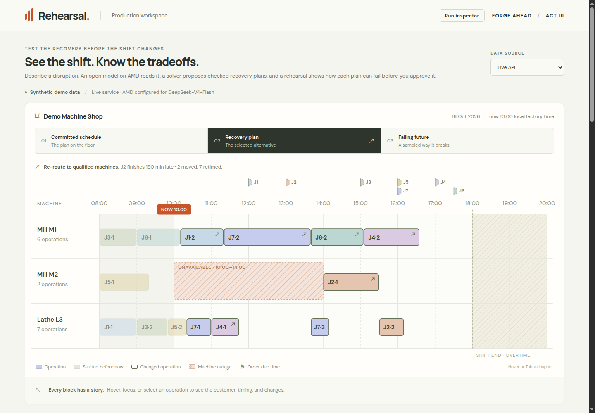

# Rehearsal

**Test a factory's recovery plan before changing the shift.**

A machine stops. A critical order still has to ship. Rehearsal helps a production
planner turn the supervisor's message into checked recovery alternatives,
rehearse how each plan could fail, and approve the tradeoffs before exporting
new dispatch instructions.

**[Open the live app](https://rehearsal-act3.aa0brkr65f1ep.us-east-1.cs.amazonlightsail.com/)** ·
[Watch the demo](https://youtu.be/XCLzMpVXXHU) ·
[Pitch slides (PDF)](submission/Rehearsal_Pitch_Deck.pdf) ·
[Run locally](#run-locally) · [Architecture](docs/ARCHITECTURE.md) ·
[Verification](#evidence) · [Licenses](THIRD_PARTY_NOTICES.md)

Built by **Forge Ahead — Abhishek Sharma and Muskan Verma** for the
[AMD Developer Hackathon: ACT III](https://lablab.ai/ai-hackathons/amd-developer-hackathon-act-iii),
Intelligent Industry challenge. The demo uses synthetic factory data.



## Try the decision flow

1. Open the app with **Live API** selected. Click **Demo**, then **Read message**:

   > Mill M2 is unavailable until 14:00. Order J7 still needs to ship at 16:00. Overtime requires approval.

2. Inspect the source-linked proposals. Review, edit or reject anything that
   needs attention. An unresolved blocking item cannot reach the solver.
3. Click **Find recovery plans**. Compare keeping machines with re-routing.
   In the verified demo, keeping machines is infeasible; re-routing protects
   J7's hard deadline while J2 finishes 190 minutes late.
4. Select a checked plan and click **Rehearse plan**. Inspect each order's
   on-time count across 500 simulated scenarios. **Show a failure** opens a
   sampled counterexample when one is found.
5. Return to **Recovery plan**, acknowledge every required tradeoff, enter an
   approver name, and choose **Approve and export**. Download the dispatch CSV
   and decision JSON. Approval locks this decision.
6. Open **Run inspector** for the actual AMD model trace, latency, token usage,
   solver/checker results and replay settings.

The live app uses real AMD extraction with rule fallback disabled. Provider
latency varies and retries may take around a minute; progress remains visible.
**Recorded samples** is a separate, labeled preview that makes no inference,
solver or replay calls and cannot approve a new decision. For a complete
offline workflow, use the local fallback configuration below.

## What runs on AMD

| Component | Implementation | Where it runs |
| --- | --- | --- |
| Message interpretation | `DeepSeek-V4-Flash` through AMD Token Factory; typed proposals with exact source spans | AMD-hosted model API |
| Validation and human review | ID/time/source checks, contradictions, edits and blocking review | Python backend + browser |
| Recovery planning | OR-Tools CP-SAT; machine eligibility, precedence, outages, hard dates and overtime | CPU |
| Independent verification | Separate checker, also run again before replay and approval | CPU |
| Rehearsal | NumPy fixed-dispatch Monte Carlo simulation | CPU |
| Approval and exports | Server-owned plan, explicit concessions, recheck, CSV and decision record | Python backend |

The OpenAI-compatible Python SDK is a client for the configured **AMD endpoint**;
the application does not send these requests to OpenAI. No model weights or GPU
are installed in the web container. GPU replay is optional future work; no GPU
speedup is claimed. See the [architecture and state boundaries](docs/ARCHITECTURE.md).

## Run locally

Install Docker Engine/Desktop with Docker Compose and Git. From a checkout:

```bash
git clone https://github.com/AbhishekSharma55/amd-act-3.git
cd amd-act-3
cp .env.example .env
```

For real inference, fill `AMD_API_KEY` in `.env` and confirm `AMD_API_BASE` and
`AMD_MODEL` against your Token Factory catalog. The supplied example uses
`https://developer.amd.com.cn/radeon/api/v1` and `DeepSeek-V4-Flash`.
Get access through the event's [Token Factory portal](https://notebooks.amd.com/tokenfactory).
Do not commit `.env` or put the key in browser variables.

```bash
docker compose up --build --detach
curl --fail http://localhost:7860/api/health
```

Open **http://localhost:7860**. A healthy response confirms configuration is
present; a real extraction separately verifies model access. Without a key,
the UI loads and extraction reports `amd_not_configured`.

To exercise the complete workflow **without an AMD key or model request**, use
this macOS/Linux command instead. Explicit empty values override any AMD
credentials in `.env`:

```bash
AMD_API_BASE= AMD_API_KEY= AMD_MODEL= ALLOW_RULE_FALLBACK=1 \
  docker compose up --build --detach
python3 scripts/container_smoke.py http://localhost:7860 --mode fallback
```

The fallback labels its interpretation as **rule fallback, not AMD**; solving,
checking, replay and exports still execute. Restore strict live mode with
`docker compose up --detach` after configuring `.env`. Stop local containers
with `docker compose down`.

See [Docker settings and troubleshooting](docs/DOCKER.md) and
[native development, Windows setup and tests](docs/DEVELOPMENT.md).
The repository is public and can be cloned directly for the hackathon submission.

## Evidence

The [public AWS workflow record](deploy/lightsail/verification/public_live.json)
passed real AMD extraction, the agreed demo facts, solving, independent checking,
500-scenario replay, concession approval, exports, idempotency and evidence
locking. A [fresh Chrome check](deploy/lightsail/verification/browser_live.json)
completed the same flow and read both download blobs. Desktop and emulated
390 px phone layouts passed; a physical phone was not tested.

### Provisional extraction evaluation

| Extractor / label set | Complete changes | Wrong proposals marked `ok` | Required review raised | API errors |
| --- | --- | --- | --- | --- |
| Offline rules / Muskan | 13/23 | 2 | 9/12 | 0 |
| AMD, clarified prompt / Muskan | 23/23 | 0 | 12/12 | 0 |
| Same AMD predictions / Abhishek | 21/23 | 0 | 9/10 | 0 |

These are **development checks on 23 team-written messages**, not an independent
benchmark. The messages informed prompt changes. Both label sets remain
provisional; the AMD predictions miss Abhishek's complete-change criterion on
two messages. No reconciled final score is claimed.
“Complete changes” follows the matching rule in [the evaluation guide](eval/README.md).
See the [rule baseline](eval/results/extraction_rules.md),
[AMD results](eval/results/extraction_amd.md),
[alternate-label scoring](eval/results/extraction_amd_abhishek.json) and
[full live report](docs/LIVE_AMD_QA.md), including the initial failures.

The [recovery comparison](eval/results/recovery.md) covers seven frozen synthetic
scenarios, including the demo case and an infeasible case. It compares a CPU
CP-SAT reference with plan selection using and hiding rehearsal results.
Selection and outcome seeds are separate. The per-policy solve budget is the
same, but Rehearsal runs multiple policies, so total compute budgets differ.
The table retains unchanged outcomes and tradeoffs; it does not establish
real-world delivery gains or superiority to a production scheduling system.

Reproduce offline checks and rescore saved predictions using
[the development guide](docs/DEVELOPMENT.md#checks-and-evaluation).
CI runs backend/frontend tests, planning regressions, saved-checker freshness,
and strict/fallback Docker workflows. CI makes no AMD requests.

## Assumptions and limits

- The fixture has seven orders, three machines and 15 operations on one day.
  There is no ERP connection, upload flow, live factory data or automatic dispatch.
- Simulation keeps machine order and planned start floors fixed; it does not
  re-optimize every sampled future. Defaults are 500 samples, seed 7, duration
  factors `triangular(0.9, 1.0, 1.3)`, and repair overruns of 0–90 minutes.
  Interrupted running work follows the declared full-restart policy.
- “On time in X of N” describes these synthetic assumptions, not calibrated
  factory reliability. A valid nominal schedule does not prove the message was
  understood correctly. People remain responsible for review and concessions.
- Runs and approvals are in memory, normally expire after six hours, and vanish
  on restart or deployment. Use one API worker and one replica; download exports
  before stopping. The approver name is an acknowledgment, not authenticated identity.
- This shared demonstration has no login or tenant isolation. Use synthetic
  messages; run IDs are lookup identifiers, not an access-control system.
- Customer adoption, planner time savings, business ROI and GPU performance
  have not been validated.

The AWS demo uses one Small Lightsail container. Hosting, lifecycle and the
scheduled **15 November 2026, 00:01:47 IST** expiry are documented in
[the deployment guide](docs/AWS_DEPLOYMENT.md).

## Repository guide

| Path | Contents |
| --- | --- |
| `frontend/` | React workspace, timeline, review, alternatives, rehearsal and approval UI |
| `backend/app/` | FastAPI routes, AMD extraction, validation, solver, checker, replay and stores |
| `shared/` | Team-authored synthetic fixture, recorded examples and checked reports |
| `eval/` | Messages, two label sets, frozen recovery cases, scripts and saved results |
| `docs/` | Architecture, setup, deployment and verification reports |
| `deploy/lightsail/` | Deployment helper, expiry configuration and public verification evidence |
| `licenses/` | Dependency inventory and preserved upstream notices |
| `submission/` | Pitch deck PDF, editable PowerPoint, video link and narration |
| `plan/`, `context/`, `research/` | Original design and research provenance; historical plans may differ from the shipped app |

## License and credits

Our code, documentation and team-authored synthetic demo data are available
under the [MIT License](LICENSE). Third-party dependencies, fonts, model assets,
logos and archived source material retain their own terms; see
[third-party notices and provenance](THIRD_PARTY_NOTICES.md).

The original hackathon context and research history are preserved. They are
background sources, not required runtime assets or material relicensed by this
project. The pitch deck and video link are in [submission materials](submission/README.md).
