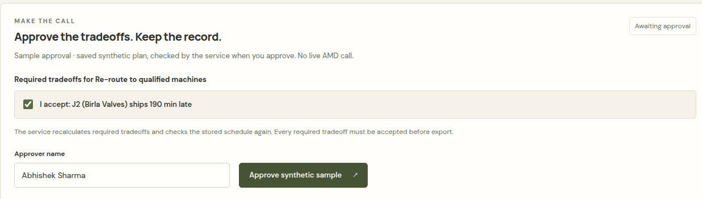
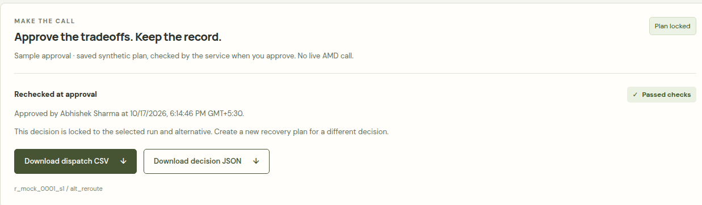
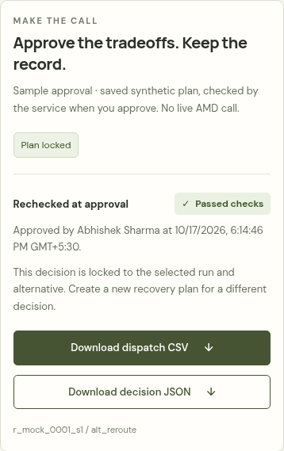

# Approval and export verification · issue #8

The feature is tested against a real local approval endpoint over saved synthetic
inputs. It does not run an AMD model, solve a new schedule, send a factory
dispatch or authenticate an approver. The live solver's fresh run IDs and shared
entrypoint will be connected by issues #2/#6; the reusable modules and mounting
instructions are ready in [backend setup](../backend/README-approval.md).

## Checks

- **54 backend tests**, including 16 approval tests, pass. These cover strict
  requests, absent/extra concessions, ignored cached concessions/KPIs/checker
  labels, fresh checker rejection, hard due dates, effective due updates,
  accepted overtime cutoffs, actual occupied overtime cost, selected policy,
  immutable snapshots, expiry, replay identity, concurrent/idempotent approval,
  exact CSV output and canonical HTTP errors.
- **19 frontend tests** pass, including five new approval tests. Requests contain
  only the four contract fields; mock transport cannot issue an approval;
  mismatched identities, runs, alternatives, checkers and concessions cannot
  enable downloads. A fresh form begins without download links.
- Production build and existing saved-checker report freshness checks pass.
- **16 full-flow browser checks** pass against the actual service. The planner
  must supply a name and accept the late delivery. Keyboard input works; a double
  click submits once. A deliberately lost response after server commit shows no
  confirmed approval, and an explicit retry retrieves the exact original record
  and timestamp. Both download links write files with the expected names and
  bytes; CSV has the expected
  header and 15 sorted operations. JSON preserves the `MOCK` trace, stored replay
  assumptions, J4's 239/500 sample count, fixture and selected schedule. Switching
  timelines or loading unrelated factory data preserves the same locked sample
  decision. Mobile width remains 390 px with no page overflow or uncaught errors.
- **Five isolated browser checks** additionally cover a new run resetting a
  pending draft, a stale success response being rejected, HTTP 410 blocking
  approval and requesting a fresh solve, a failing checker keeping approval
  disabled, and overtime minutes/cost display. These use controlled responses
  to exercise the reusable panel's future live integration.

CSV data is parsed in tests and its downloaded bytes match the expected dispatch
file. Excel itself was not available in this environment. JSON is parsed from
the actual browser download blob and compared with the committed server record.

## Run locally

Follow [the sample service instructions](../backend/README-approval.md), then open
Sample recovery. Approve J2's 190-minute late delivery and enter an approver name.
The service rechecks its stored schedule and derives the required concessions
at approval, rather than trusting the browser's schedule or saved checker flag.

After approval, the run is locked; retrying the identical request retrieves the
same record. Another identity or plan cannot overwrite it. Reset the explicitly
sample-only service and reload the page for another sample session.

