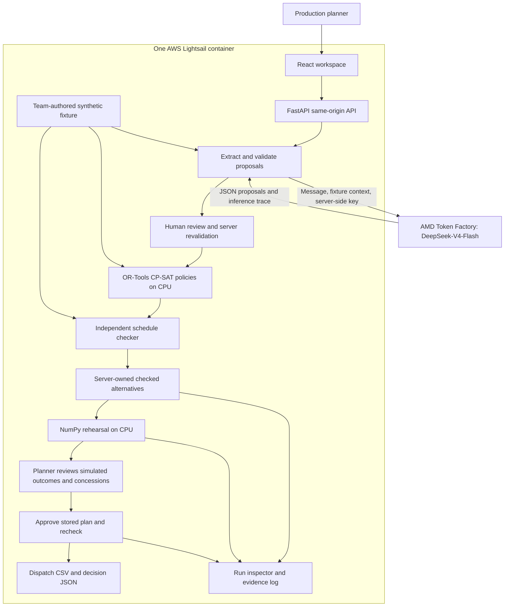

# Architecture

Rehearsal connects an operational message to an approved recovery decision.
The AMD-hosted model proposes typed facts; deterministic validation, CPU
optimization, a separate checker and a person control what reaches an export.
The deployed app uses one container and one API process.

## Request path

AMD inference runs outside the web container. CP-SAT, checking and NumPy replay
run on CPU; there is no implemented GPU replay path. The browser never receives
the API key. The SDK's configured base URL points to the AMD service.

## Implemented boundaries

| Stage | Code | Guarantee and limit |
| --- | --- | --- |
| Extract | [`extract.py`](../backend/app/extract.py), [`routes_extract.py`](../backend/app/routes_extract.py) | Up to three attempts, configured timeout per attempt, explicit provider errors. Rule fallback requires opt-in and carries its own provenance. |
| Validate/review | [`validate.py`](../backend/app/validate.py) | Checks IDs, types, times, exact source spans, conflicts and required fields. A matching quote alone does not prove semantic correctness. Edits are revalidated against the stored draft. |
| Solve | [`solver.py`](../backend/app/solver.py), [`routes_solve.py`](../backend/app/routes_solve.py) | Keeps eligible machines, precedence, no-overlap, outages and working limits. Separates keep-machines, re-route and allowed-overtime policies; merges identical plans. UNKNOWN is distinct from proven infeasibility. |
| Check | [`checker.py`](../backend/app/checker.py) | Separate rule implementation, with no solver import. Rejects invalid nominal schedules. It does not validate the model's interpretation of the original message. |
| Rehearse | [`replay.py`](../backend/app/replay.py), [`routes_replay.py`](../backend/app/routes_replay.py) | Checks the stored nominal schedule first, then samples declared duration/repair assumptions without changing machine order. Sampled timelines are evidence under those assumptions, not fresh nominal checker passes. |
| Approve | [`approval.py`](../backend/app/approval.py), [`approval_store.py`](../backend/app/approval_store.py) | Retrieves the stored plan, rechecks it and derives concessions again. Accepts only IDs, approver name and concession acknowledgments. A client-supplied plan or checker result cannot authorize export. |
| Inspect | [`main.py`](../backend/app/main.py), [`RunInspector.jsx`](../frontend/src/components/RunInspector.jsx) | Exposes actual trace and step evidence. Stored messages/raw output are visible to anyone holding the run ID; this is a shared synthetic demo. |

Hard-date conflict sets come from sufficient CP-SAT assumptions. They are not
claimed to be minimal diagnoses. The application does not silently relax a hard
deadline to make an alternative feasible. Overtime permission is a proposed
option; any actual overtime concession still requires explicit approval.

## Run lifecycle and authority

1. `/api/extract` creates a draft with the original message, model proposals,
   validated constraints and trace.
2. `/api/constraints/revalidate` checks planner changes. `/api/solve` also
   revalidates submitted decisions and creates a fresh solve run.
3. The solve run owns its fixture, reviewed constraints, policies and checked
   schedules. [`runstore.py`](../backend/app/runstore.py) serves inspector
   evidence; the process-wide [`ApprovalStore`](../backend/app/state.py) owns
   the approval snapshots and attached replay results.
4. `/api/replay` reads an alternative by ID and saves its result for that same
   run/alternative. It cannot replace an already approved decision.
5. `/api/approve` recalculates concessions and verifies the stored plan before
   returning CSV and decision JSON. Identical retries return the same committed
   exports; a conflicting approval is rejected.

The UI clears downstream plans, rehearsal and approval when their inputs change.
It cancels superseded requests and ignores late responses from an older context.
After approval, the selected decision and rehearsal settings are locked in the UI.

All stores and rate counters live in process memory. The default run TTL is
21,600 seconds with a 2,000-run bound; the AWS service uses a 250-run bound.
Restarting loses state. One Uvicorn worker and one replica are required.
There is no database, authenticated sign-in, multi-tenant authorization or ERP
writeback. An approver name records an acknowledgment, not verified identity.

## Rehearsal model

- Completed work is fixed. Running work keeps observed start/elapsed history;
  only its remaining work is randomized initially.
- Unstarted durations are multiplied by `triangular(0.9, 1.0, 1.3)` by default.
  Each repair whose window ends after `now` receives a uniform 0–90 minute
  extension. Defaults: 500 samples, seed 7.
- Machine assignments/order and planned start floors stay fixed. Work waits
  for its predecessor and machine availability. There is no per-sample optimizer.
- If a running attempt crosses a future outage, its interrupted work is scrapped
  and the full operation restarts after repair using the same sampled duration
  factor. Timeline segments preserve processing history and repair waits.
- On-time counts, p90 finish times and a selected failure describe these
  synthetic assumptions. They are not calibrated probabilities of factory success.

See [the running-outage regression report](RUNNING_OUTAGE_QA.md) and
[evaluation definitions](../eval/README.md).

## Delivery and operation

The [Dockerfile](../Dockerfile) builds the React assets with Node 22 and installs
Python dependencies in a separate stage. The runtime has Python 3.12, static
frontend assets, the synthetic fixture and license notices; it runs as UID/GID
1000 with one worker. Node and development tests are absent from the runtime.

`/api/health` checks application/fixture availability and reports AMD
configuration, fallback mode and replay device. It makes no model call and does
not prove a key works. [`container_smoke.py`](../scripts/container_smoke.py)
provides strict, offline-fallback and live-AMD checks of the packaged app.

Lightsail terminates HTTPS and forwards to port 7860. The current single Small
instance uses one CP-SAT worker; deployment replaces in-memory sessions.
See [AWS configuration, observed latency, costs and expiry](AWS_DEPLOYMENT.md).
