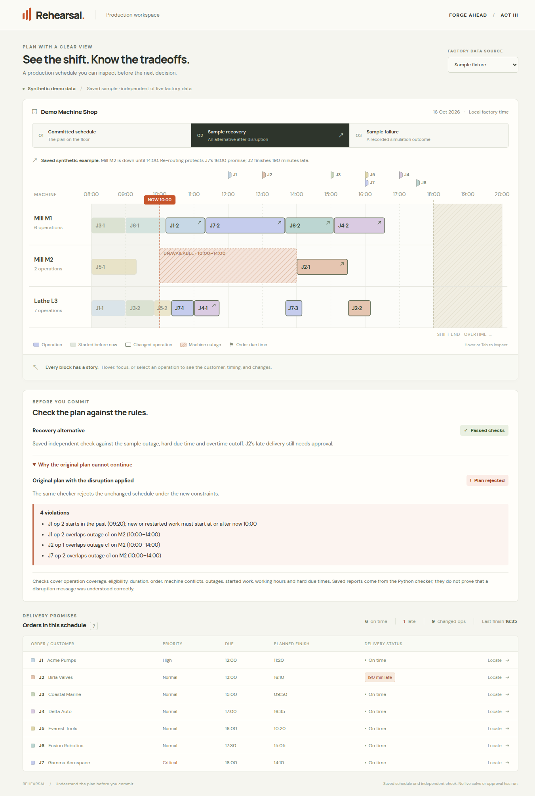
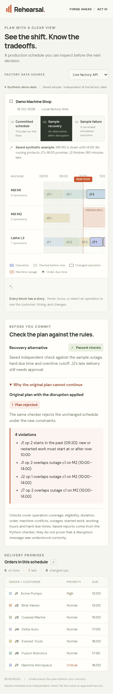

# Independent checker · issue #4

The checker verifies schedules without importing the solver or contacting AMD.
It returns the existing `{valid, violations}` contract used by alternatives
and approval. Integration into those future endpoints remains with their
respective issues; no new HTTP endpoint was added here.

The UI displays saved results calculated by this checker for the checked
synthetic fixture. Sample recovery includes an expandable comparison showing
why the original plan fails under the disruption constraints. A passing check
does not approve late delivery or prove that extraction understood a message.

Live factory data without a report and the sampled failure timeline both show
“Not checked.” The failure timeline uses varying processing times, so the
fixed-duration dispatch checker is not the appropriate validator for it.

## Verified results

- **38 backend tests** pass, including 32 checker/report tests and the six
  existing factory tests. Positive committed/recovery samples pass. The
  unchanged plan under the disruption reports four violations.
- **14 frontend tests** pass. Saved checks are tied to source-file and checker
  hashes; missing, malformed or contradictory results cannot show a pass.
  Every violation renders as escaped text.
- **Production frontend build** and deterministic report freshness check pass.
- **Nine browser checks** pass: saved pass labels, outstanding late-delivery
  approval, keyboard disclosure of all four violations, sampled-future and
  live-factory unverified states, correct sample provenance after switching
  sources, factory-only network request, mobile layout, and no uncaught errors.
  At 390 px the expanded violation list stays within the viewport.
- An additional local robustness probe exercised **494 JSON-shape mutations**
  across fixture, constraint and schedule fields without exceptions, mutation
  of inputs or inconsistent result shapes.

The overtime boundary test permits 18:30 and rejects 18:31 when the accepted
cutoff is 18:30, although the fixture allows overtime to 20:00. Running work
intersecting an outage must restart with the full duration; completed historical
observations remain frozen. Exact outage and operation endpoints may touch.





## Reproduce

From the repository root, with the factory development dependencies installed:

```bash
python3 -m unittest discover -s backend/tests -v
PYTHONPATH=backend python3 -m app.checker_report --check
```

From `frontend/`:

```bash
npm ci
npm test
npm run build
npm run dev -- --port 5173
```

See [checker rules and integration](../backend/README-checker.md) and
[frontend setup](../frontend/README.md). The shared API contracts, fixture and
six saved endpoint responses remain unchanged.
