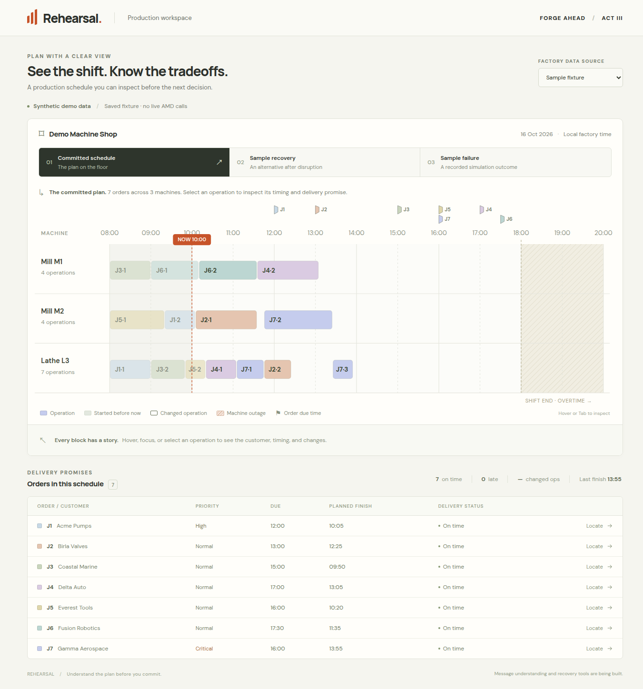
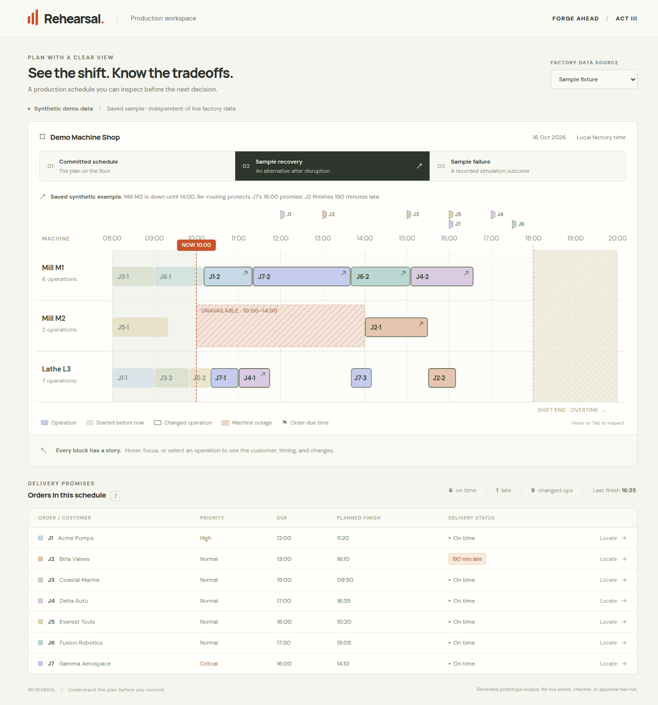
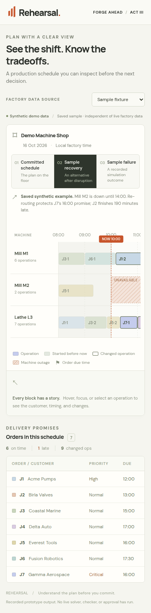

# Factory view: verification for issue #3

This feature can run from checked sample data without an AMD API key or the
shared backend foundation. The live factory view needs only `GET /api/factory`.
Recovery and failure views are saved synthetic examples, clearly labeled in the
interface; no live solver, replay, checker or approval is claimed.

## Run and integration

- [Frontend setup and component/transport interfaces](../frontend/README.md)
- [Factory-only API setup and mount instructions](../backend/README-factory.md)
- [Agreed API contract](../plan/03_API_CONTRACT.md)

The shared fixture and six mocks are unchanged copies of the checked plan.
Muskan can mount `app.factory.router` in the shared application. This branch
does not introduce `backend/app/main.py`.

## Automated checks

The implementation passed 11 frontend tests and 6 backend tests, plus a
production frontend build, using Node 24.21.0 and Python 3.14.4:

```bash
cd frontend
npm ci
npm test
npm run build
```

From the repository root after installing the backend development dependencies:

```bash
backend/.venv/bin/python -m unittest discover -s backend/tests -v
```

## Independent browser checks

Chrome 149 was exercised at a 1366 × 768 desktop viewport and a 390 × 844 mobile
viewport. The browser pass covered the following behaviors:

| Check | Observed result |
| --- | --- |
| All three schedules | All 15 operations in each view match the source machine, start/end times and timeline positions |
| Committed plan | Started-work styling follows the fixed 10:00 factory time; all seven jobs finish on time |
| Markers | Current-time position is correct; J5 and J7's coincident 16:00 due flags occupy different lanes |
| Saved recovery | J2 is visibly 190 minutes late and J7 remains on time |
| Saved failure | J4's sampled 61-minute miss is visible; the outage is labeled nominal because sampled repair-end metadata is absent |
| Inspection | Keyboard focus and Enter show the matching operation/customer details |
| Order location | Locate highlights only the selected order's operations; controls remain keyboard accessible |
| Mobile | The document stays 390 pixels wide; the timeline and order table scroll inside their own containers |
| Live factory | Direct and Vite-proxied requests return the complete checked fixture; the development app exposes only `/api/factory` |
| Live feature independence | Browser requests use `/api/factory` without requiring extraction, solver or replay endpoints |
| Failure/retry | An unavailable factory API shows an error without silently substituting sample data; Retry recovers when access returns |
| Source provenance | Switching between live factory and saved examples keeps their data sources explicit and resets to the correct committed schedule |

No uncaught JavaScript exceptions were observed in the live/error/retry pass.
These are feature checks, not evidence that the future AMD integration or
complete product is finished. Deployment and other features remain separate
issues.

## Screenshots

Committed schedule, desktop:



Saved recovery, desktop:



Saved recovery, mobile (timeline and table scroll horizontally):


