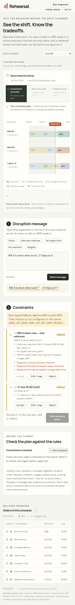
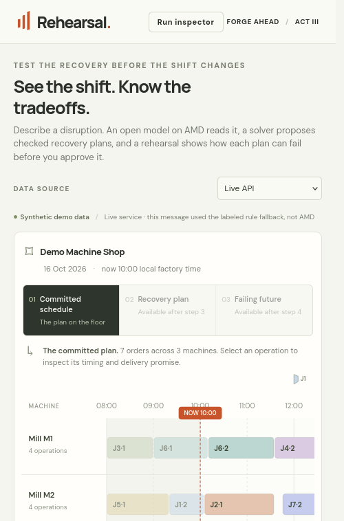
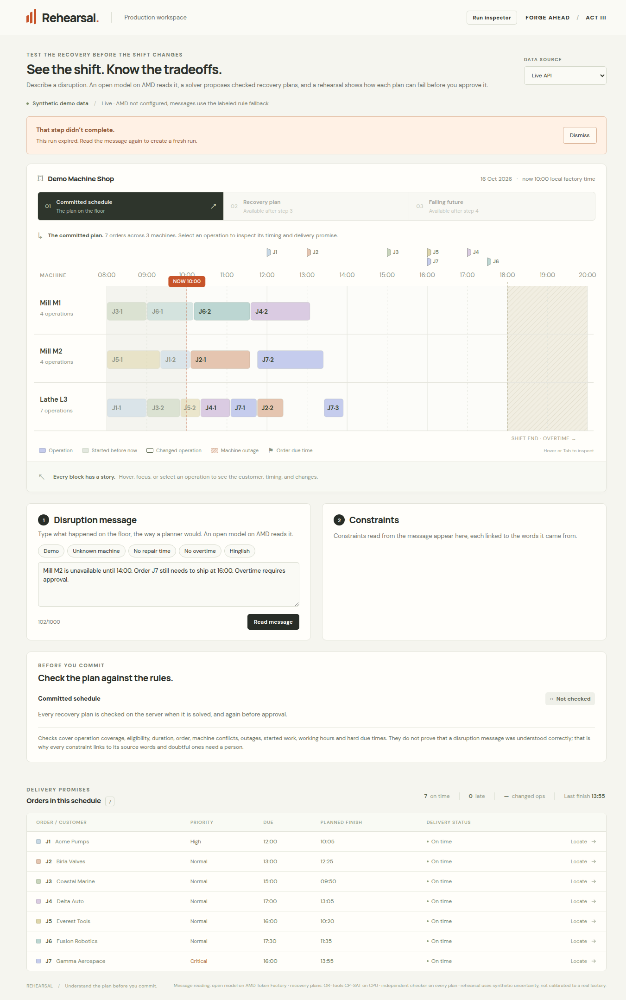

# Workflow robustness · issue #11

This change is based on the proposed workflow in PR #26 so it covers the real
message → review → solve → replay → approval flow. It does not merge that PR or
its backend dependencies. The implementation is prepared for integration; the
independent review of PRs #22–#27 is a separate next step.

## Behavior

- A single workflow request can run at a time. Duplicate clicks do not submit
  another operation. Every request has a cancellation signal and a revision;
  cancelled/superseded results cannot update the current plan even if the server
  finishes later. Source changes and component cleanup cancel pending work.
- Editing messages or constraints clears recovery, rehearsal and approval.
  Starting a fresh extract/solve/revalidation also removes old decisions before
  waiting for the response. Editing rehearsal assumptions clears old sampled
  outcomes and the failing-future tab. Expired runs require a new extraction.
- One notice pattern provides progress, cancellation, errors and explicit retry.
  The transport has a two-minute deadline including reading the response body;
  there are no automatic model-call retries in the browser. Canonical backend
  retryability is preserved, including nonretryable missing AMD configuration.
- Empty or overlong messages cannot submit. Blocked/undecided constraints cannot
  solve. Response structure/clocks are checked before rendering incomplete API
  payloads. A failed checker cannot enable replay or approval. UNKNOWN solver
  results are distinct from proven infeasibility.
- A confirmed approval locks plan-selection/rehearsal controls for that run.
  A changed message/constraint creates a new decision context. Recorded previews
  cannot be approved as if they were server-owned runs; the live service must
  produce the run first. Actual fallback use stays visible even if AMD was
  configured, and no result is silently replaced by a recorded sample.
- Inspector requests are cancelled when context changes; old logs cannot be
  attached to a different run. Existing approval identity checks and idempotent
  retry behavior remain in place.

## Verification

The backend suite passes **119 tests and 97 subtests**. The frontend passes
**30 tests**, including six new request-lifecycle/transport/response-boundary
checks. Production build and saved-checker report freshness pass.

Browser verification uses isolated Chrome and Firefox profiles, never the user's
signed-in browser profile. Both run a complete local service flow using the
**explicitly labeled rule fallback**. No AMD request or paid resource is used.

- **19 cross-browser checks:** empty/long inputs, real fallback labels, actual
  infeasibility/recovery, changed replay assumptions, approval/export, locked
  controls, editing after approval, unknown-machine review gates, responsive
  layout and no uncaught Chrome exceptions. Chrome uses a 390 px mobile viewport;
  headless Firefox clamps its narrow window to 500 px, still exercising the
  mobile layout breakpoint.
- **10 controlled failure checks:** offline factory and retry, unavailable AMD,
  malformed success payload, cancelled work, source change during a request,
  duplicate solve, honest UNKNOWN, no sampled failure, and expired runs. These
  cases render clear states without uncaught browser exceptions or sample
  substitution.
- **Two additional browser checks:** recorded previews expose no approval form,
  and the built frontend starts in live mode with the server's fallback status
  visible. Total: **31 browser checks**.

These checks establish local robustness, not live AMD availability or deployment
readiness. Those checks must be repeated on the combined deployed application
with the actual model/key, after the pending PRs are reviewed and integrated.

## Reproduce

From this feature checkout, install `backend/requirements-dev.txt` and run:

```bash
python -m pytest -q backend/tests
PYTHONPATH=backend python -m app.checker_report --check
```

From `frontend/`, run `npm ci`, `npm test`, and `npm run build`. For local UI QA,
start the shared backend with `ALLOW_RULE_FALLBACK=1` and empty AMD configuration,
then `npm run dev -- --port 5173`. Choose Live API. This uses actual local
validation, solving, checking, replay and approval while clearly labeling the
fallback interpretation. The existing shared backend owns its API errors and
run-store rules; this change adds the browser safeguards.






