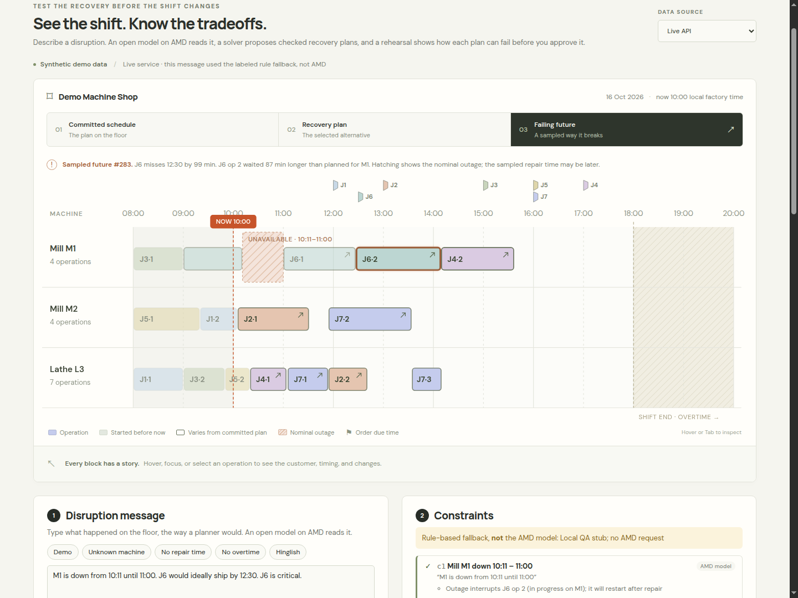

# Running-work outage handling — issue #31

If sampled remaining work crosses a future outage, the interrupted attempt is
scrapped. After sampled repair, the full operation restarts using the same
sampled duration factor. Subsequent outages can interrupt that attempt too.
Observed history is retained and completion delays propagate through job and
machine dependencies. These are explicit synthetic assumptions.

The selected failure exposes processing `segments`, including the discarded
attempt and final restart. The timeline paints those segments with a repair gap
while retaining one logical operation. The outer start/end is elapsed time,
including scrapped work and waiting; an overlap of that outer interval with an
outage no longer means processing occurred through it. Use segments or the new
regressions to assess processing, rather than the original review script's
outer-interval overlap count. Approval/export retains the actual segments and
the declared `assumptions.running_work` policy.

## Verification

- The checked M1 outage **10:11–11:00** reproduction retains J6 operation 1's
  observed **09:00** start. The **156/500** crossing samples now restart after
  repair for a full operation duration; unaffected samples finish before the
  outage. Seed 7, spread [0.9, 1.3], zero repair overrun.
- Seven new backend cases cover the seeded reproduction, dependent-operation
  delay, failure segments, repeated outages, overlapping sampled repairs,
  zero-noise/completed history, and retained approval evidence. Four of the
  first five cases failed on the original replay baseline before the fix.
- On the latest replay parent: **130 backend tests and 97 subtests pass**. Its frontend
  passes **20 tests** and the production build, including a React-rendering
  regression for the real gap and one logical operation.
- An isolated checkout combining PRs #22–#29 and both fixes passes **136 backend
  tests, 97 subtests, 31 frontend tests, production build, saved-checker freshness
  and 20 planning regressions**.
- Recovery evaluation was rerun on that checkout. **All 19 saved result rows
  are exactly unchanged**; only run timestamp metadata differs, so no new
  result artifact is committed.
- **Eight Chrome checks** on the built combined application cover startup,
  unresolved deadline mapping and HTTP 422, explicit confirmation, the actual
  interruption gap, exported evidence, 390 px layout and no uncaught exceptions.
  Browser extraction uses deterministic local stubs; solving, checking, replay
  and approval use the real local backend. No AMD call or paid resource is used.

The combined checkout incorporates Muskan's parallel parent updates, including
`52009ac`. The parent's added
restart regression is retained and checks actual processing attempts rather
than treating the elapsed historical start/end as continuous machining. The
observed start stays fixed. Parent updates were brought into this fix branch;
main and teammate branches were not modified by this work.



## Reproduce

With backend development dependencies installed:

```bash
AMD_API_KEY='' AMD_API_BASE='' AMD_MODEL='' python -m pytest -q backend/tests
```

From `frontend/`: `npm ci`, `npm test`, `npm run build`. On the combined checkout
containing #27, run `python eval/run_eval.py recovery`; compare its rows with the
frozen results, excluding timestamp metadata.

The fix PR targets the active replay branch behind #25. Merge it there before
integrating #25 into main; if #25 lands first, retarget the fix to main.
