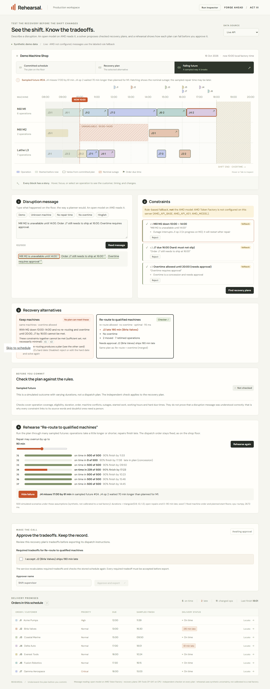
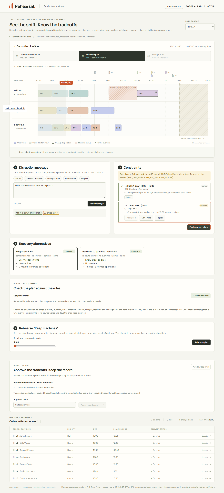
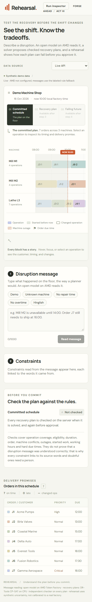

# Workflow verification · issues #5, #6, #7, #9

The workspace now runs the whole flow against the live API: message → reviewed constraints → checked recovery
alternatives → rehearsal → approval (#8 panel). "Recorded samples" keeps the saved responses for offline UI work and
says so on screen. All factory data and uncertainty are synthetic.

**Not yet verified:** a real AMD Token Factory call. Our account was not yet registered for key distribution, so
these checks ran with the labeled rule fallback (`ALLOW_RULE_FALLBACK=1`), which the UI and inspector mark as
"fallback (not AMD)". The extraction path itself is covered by stubbed-model tests.

## Checks

- **Backend:** 119 tests across the stack (validation, solver, checker, replay, approval and every API route,
  including error shapes, expiry, rate limiting, forged spans and client-supplied plan data).
- **Frontend:** 24 tests, including 5 for the workflow: blocking items stay unready after Accept, the solve payload
  drops rejected items and UI-only fields, outages/due dates come only from reviewed constraints, and the cards and
  rehearsal use honest wording ("No plan found in budget" for UNKNOWN; "X of N simulated scenarios", never
  reliability).
- **41 browser checks** in Edge against the built app served by FastAPI:
  - input limits (empty, 1001 characters, emoji/HTML);
  - demo: 3 source-linked constraints, interrupted-work note, outage on the timeline;
  - solve: keep-machines infeasible with conflict `c1 c2`, re-route with J2 190 min late, checker passed,
    merged duplicate plan, 9 changed operations outlined, before/after views;
  - rehearsal: J4 on time in 239 of 500, failing future #24 (J4 61 min late) with the bottleneck highlighted,
    repair-delay slider re-runs;
  - approval through the #8 panel: disabled until the concession is ticked and named, then both downloads;
  - inspector: fallback labeled, step log extract → solve → replay → approve;
  - review: unknown machine cannot be accepted; Edit/map + server revalidation makes it ready; reject/undo;
    missing repair time is never invented; no-overtime and Hinglish messages;
  - no page-level horizontal scroll at 390 px; no console errors.

## Screenshots

| Failing future | Review and edit | Mobile |
| --- | --- | --- |
|  |  |  |

## Run

```bash
cd frontend && npm ci && npm run build
cd ../backend && ALLOW_RULE_FALLBACK=1 ../.venv/Scripts/python -m uvicorn app.main:app --port 8000
```

Open <http://localhost:8000>. With `.env` holding Token Factory values, the same build calls AMD and the header shows
the model in use. `npm run dev` (port 5173) keeps the recorded samples by default, as before.
